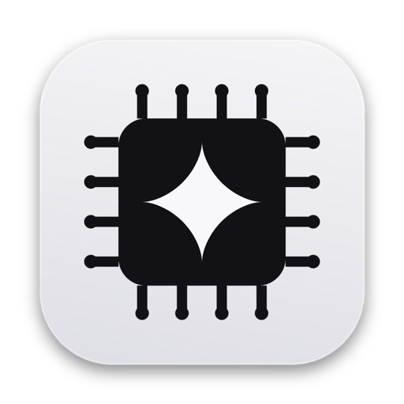
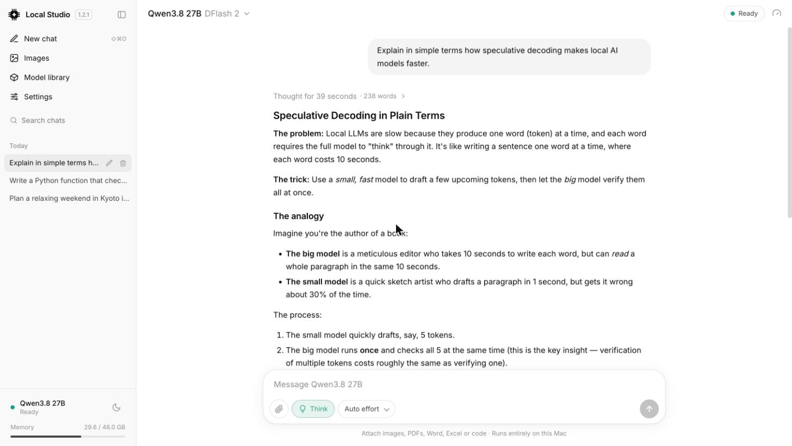
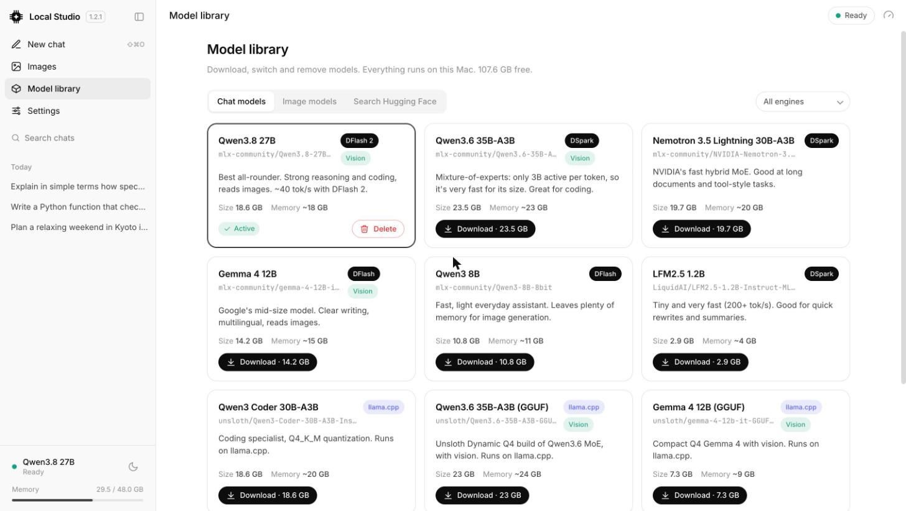
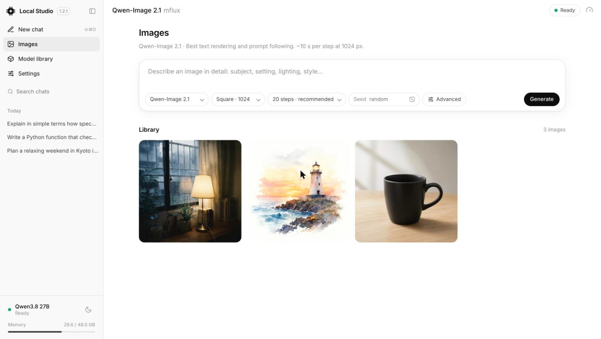

# Local Studio



A private, on-device AI studio for Apple Silicon Macs. Chat with models like **Qwen3.8-27B**
accelerated by **DFlash/DSpark** speculative decoding or any **GGUF** model on **llama.cpp**, ask
about images and documents, and generate images with **Qwen-Image 2.1**, **Z-Image Turbo** or
**FLUX.2 Klein**. Everything runs locally; nothing leaves your Mac.

[](LICENSE) **Version 1.3.0**



| Model library | Images |
|---|---|
|  |  |

## Features

- **Chat**: streaming replies, collapsible "thinking", effort control, saved conversations with
  search/rename/delete, copy and regenerate, and per-reply performance details (tok/s, speed-up,
  accept length, time to first token, cached tokens).
- **Attachments (multimodal)**: attach with the paperclip, drag and drop, or paste. Ask about
  images (Qwen3.8 vision), PDFs, Word (.docx), Excel (.xlsx), and text/code files. Scanned PDFs
  are read as page images.
- **Images**: text-to-image with aspect presets, steps, seed, guidance and step caching; live
  progress with ETA and cancel; a library with full-size view, reuse settings, download and delete.
- **Model library**: one-click download, switch and delete for a curated set of chat and image
  models, plus search across Hugging Face for any MLX or GGUF model (pick the quantization).
  Switch the chat model from the header; the right engine starts automatically.
- **Settings**: start/stop the engine, see versions, update the engines in one click, clear
  images, chats, uploads, logs and caches, and uninstall everything.
- **API**: the engine serves OpenAI- and Anthropic-compatible endpoints at
  `http://127.0.0.1:8080/v1`, usable from Claude Code, scripts or other local apps.

## Requirements

- Mac with Apple Silicon (M1 or newer), macOS 15+
- 32 GB RAM minimum; 48 GB recommended (all numbers below are from a 48 GB M4 Pro)
- ~30 GB free disk space for the models
- Internet only for the one-time install and model downloads

## Install

### The easy way (recommended)

1. Download **Local-Studio-1.3.0.dmg** from the [latest release](https://github.com/vinoth12940/local-studio/releases/latest).
2. Open it and drag **Local Studio** into **Applications**.
3. Open Local Studio. On first launch it checks the Mac and offers **Install**, which sets up the
   engines (uv, mlx-dspark, mflux, llama.cpp: about 3 GB, a few minutes; no Terminal, Homebrew
   or Xcode needed).
4. Pick your first model. Local Studio recommends models that fit your Mac's memory, and chat
   unlocks when the download finishes.

Requirements: Apple Silicon (M1 or newer), macOS 14+, 16 GB RAM or more (32 GB+ for the larger
models), and disk space for the models you choose (3–25 GB each).

> If the DMG isn't notarized (see "Building a release" below), macOS blocks it on first open.
> Go to **System Settings → Privacy & Security → Open Anyway**, then open it again.

### From source (developers)

```sh
git clone https://github.com/vinoth12940/local-studio.git ~/local-studio
cd ~/local-studio
./setup.sh --install        # engines only; or ./install.sh for engines + default models
./start.sh                  # then open http://127.0.0.1:7860
```

When run from a checkout, user data stays in the checkout folder. The Mac app keeps it in
`~/Library/Application Support/Local Studio` and, on its first launch, copies existing images,
chats and settings over from `~/local-studio`.

## Mac app

`Local Studio.app` is self-contained: the code ships inside the app bundle
(`Contents/Resources/app`) and user data lives in `~/Library/Application Support/Local Studio`.

- Opening the app checks that the engines are installed (and offers to install them), then starts
  the engine and interface automatically.
- Quitting (⌘Q) stops everything and frees the model's memory. Check
  **Local Studio → Keep Running After Quit** to keep the servers running in the background.
- **Local Studio → Repair or Update Engines…** re-runs the installer.
- **Local Studio → Show Data Folder** opens your images, chats and logs.
- Closing the window keeps the app in the Dock; click the icon to bring it back.

### Building a release

```sh
macos/build.sh --install   # build Local Studio.app and copy it to /Applications
macos/release.sh           # build the app and build/Local-Studio-<version>.dmg
```

The app is signed with a **Developer ID Application** certificate when one is installed (otherwise
your Apple Development certificate, which only works on your own Macs). To ship a DMG that opens on
any Mac without warnings:

1. In your Apple Developer account, create a **Developer ID Application** certificate
   (Certificates → +) and install it in Keychain.
2. Create an app-specific password at appleid.apple.com, then store notarization credentials once:
   `xcrun notarytool store-credentials notary --apple-id YOU@icloud.com --team-id YOURTEAMID`
3. Run `macos/release.sh`. It signs, notarizes and staples the DMG automatically.

## Use

```sh
./start.sh          # engine + UI (from a source checkout), then open http://127.0.0.1:7860
./start.sh --ui     # UI only; start the engine later from the UI to save memory
./stop.sh           # stop everything and free memory
```

The servers listen on `127.0.0.1` only and are not reachable from other devices.

## Search your files

Turn on **Search** in Settings and Local Studio indexes your Documents, Desktop, Downloads,
Pictures, Movies, Music and iCloud Drive in the background, on this Mac. You can then:

- **Find** a file by describing it: "the invoice from the plumber", "photo of a desert plant at
  night", "voice memo about the dentist". Text, images and spoken audio are all searchable.
- **Ask** in chat with the **My files** switch on. The active chat model answers from your files
  and lists the ones it used.

Search uses [EmbeddingGemma 2](https://huggingface.co/google/embeddinggemma-2) on MLX. It is off
until you turn it on; doing so downloads the model (1.3 GB) and its components (about 1 GB) once.
Indexing pauses while you chat or generate images, and on battery power unless you allow it.
Add or remove folders, see what could not be read, and rebuild or delete the index in
Settings → Search. The index lives in `data/search/`.

Not indexed: hidden files, `Library`, apps and other packages (including the Photos library),
developer folders such as `node_modules` and `.git`, private keys, and iCloud files that are not
downloaded. Video files and unrecognised types are found by name only.

## Models

Chat models (one-click in the Model library; sizes are download sizes):

| Model | Engine | Size | Notes |
|---|---|---|---|
| Qwen3.8 27B (default) | MLX + DFlash 2 | 18.7 GB | Best all-rounder, vision, ~40 tok/s |
| Qwen3.6 35B-A3B | MLX + DSpark | 23.5 GB | Fast MoE, vision, coding |
| Nemotron 3.5 Lightning 30B-A3B | MLX + DSpark | 19.7 GB | Fast hybrid MoE |
| Gemma 4 12B | MLX + DFlash | 14.2 GB | Multilingual writing, vision |
| Qwen3 8B | MLX + DFlash | 10.8 GB | Light everyday model |
| LFM2.5 24B-A2B | MLX | 13.6 GB | Reasoning MoE (2B active), agents and tool use, ~85 tok/s (measured) |
| LFM2.5 1.2B | MLX + DSpark | 2.9 GB | Tiny, ~200 tok/s (measured) |
| Qwen3 Coder 30B-A3B | llama.cpp (GGUF Q4_K_M) | 18.6 GB | Coding |
| Qwen3.6 35B-A3B | llama.cpp (GGUF UD-Q4_K_M) | 23.0 GB | Vision via mmproj |
| Gemma 4 12B | llama.cpp (GGUF Q4_K_M) | 7.3 GB | Vision via mmproj |
| Qwen3.5 9B | llama.cpp (GGUF Q4_K_M) | 6.6 GB | Vision via mmproj |

Image models: Qwen-Image 2.1 (default, 9.6 GB), Z-Image Turbo (5.9 GB, ~9 steps) and
FLUX.2 Klein 4B (4.6 GB, 4 steps; a 1024 px image took 27 s on an M4 Pro).

Anything else: Model library → Search Hugging Face. MLX repos run on the accelerated engine
(without a drafter unless it's in mlx-dspark's registry); GGUF repos run on llama.cpp, and
ticking "Vision" also downloads the repo's mmproj file. The catalog lives in `catalog.json`.

## How the engines work

Only one engine runs at a time, so memory stays free for the model:

| Engine | Runs | Port |
|---|---|---|
| mlx-dspark | MLX chat models with DFlash/DSpark speculative decoding (text) | 8080 |
| mlx-vlm | The same MLX model when a chat contains an image | 8081 |
| llama.cpp (`llama-server`) | GGUF models, including images when an mmproj is present | 8082 |

Switching models or engines takes about 5–30 s depending on model size; the chat shows a
"Loading …" message meanwhile.

## How attachments work

Qwen3.8-27B is multimodal, but the fast DFlash engine (mlx-dspark) is text-only. Local Studio
therefore runs one of two engines on the same weights, never both (each needs ~16 GB):

| Engine | Used for | Speed (measured) |
|---|---|---|
| Text: mlx-dspark + DFlash 2 | Chats without images, including document attachments | ~40 tok/s |
| Vision: mlx-vlm server | Chats that contain an image or scanned PDF | ~20 tok/s, ~10 s to read an image |

The app switches automatically when a chat needs the other engine. GGUF models with an mmproj
read images directly on llama.cpp, with no switch. Models without vision show a clear message.

Documents are converted to text when you attach them (PDF via pypdf, Word via python-docx, Excel via
openpyxl, text and code as-is) and added to your message. Each document is capped at about 20k
tokens so the 32k context keeps room for the answer; longer files are marked "truncated". Images are
downscaled to 1536 px. Scanned PDFs (no text layer) send their first 4 pages to the vision engine.
Files stay in `uploads/` on this Mac.

## Performance (M4 Pro, 48 GB)

| | Result |
|---|---|
| Qwen3.8-27B 4-bit, plain decoding | 15.0 tok/s |
| Same model with DFlash 2 | **41.7 tok/s (2.78×)**; chat 2.0×, code 3.1×, math 3.25× |
| Chat engine memory | ~16 GB resident, ~19 GB peak |
| Image, 1024px | ~10.5 s per step in low-RAM mode, ~10 GB peak |

The "vs plain" figure under each reply compares against the engine's theoretical plain-decoding
ceiling, so it reads slightly lower than the benchmark speed-up.

Image jobs run with mflux `--low-ram`. Without it, generation peaked at ~38 GB and pushed macOS
into critical memory pressure while the chat engine was loaded. Chat and image generation share
the GPU, so running both at once slows each down.

Re-run the benchmark yourself:

```sh
mlx-dspark benchmark --model mlx-community/Qwen3.8-27B-4bit --modes dflash --caps auto --trials 3
```

## Image editing

Editing (`mflux-generate-qwen-2.1-edit`) needs the full `Qwen/Qwen-Image-2.1` checkpoint
(33.1 GB); the 4-bit export used here is text-to-image only, so the UI offers generation only.
The backend accepts `mode=edit` on `POST /api/image` when started with
`EDIT_MODEL=Qwen/Qwen-Image-2.1` (after downloading that checkpoint). Stop the chat engine while
editing, as the full checkpoint needs a lot of memory.

## Updating

Settings → **Update engines** runs `uv tool upgrade mlx-dspark mflux` and `brew upgrade llama.cpp`
and shows what changed. Restart the engine afterwards. Pull new app versions with `git pull` and
rebuild the Mac app with `macos/build.sh --install`.

## Configuration

Environment variables read by `app.py`:

| Variable | Default |
|---|---|
| `EDIT_MODEL` | unset (image editing disabled) |
| `HF_HUB_CACHE` | `~/.cache/huggingface/hub` |

The active chat and image models and any models added from Hugging Face are stored in
`data/settings.json`.

## Where things are stored

| What | Location |
|---|---|
| Models (MLX and GGUF) | `~/.cache/huggingface/hub` |
| Active models, custom models | `<data>/data/settings.json` |
| llama.cpp (when installed without Homebrew) | `~/Library/Application Support/Local Studio/llama.cpp` |
| Engine calibration | `~/.cache/mlx_dspark` |
| Images | `<data>/gallery/` |
| Conversations | `<data>/data/chats/` |
| Attachments | `uploads/` |
| Logs | `logs/` |

`<data>` is `~/Library/Application Support/Local Studio` for the Mac app, or the checkout folder
when running from source. None of these folders are committed to git.

## Uninstall

From the UI: **Models & storage → Uninstall**. Or from the terminal:

```sh
./uninstall.sh               # remove tools and models, keep this folder
./uninstall.sh --remove-app  # also delete this folder (images and chats)
```

This stops the servers, uninstalls llama.cpp (Homebrew), runs `uv tool uninstall` for mlx-dspark and mflux, deletes every model in the catalog
or added from Hugging Face, removes `~/.cache/mlx_dspark`, and deletes `/Applications/Local Studio.app` if present. uv itself is left installed.

## Project layout

```
app.py          FastAPI backend: engines, chat proxy, attachments, image jobs, models, updates
catalog.json    Curated chat and image models
index.html      Single-page UI
setup.sh        Checks the Mac and installs the engines (used by the app's first-run screen)
install.sh      Engines + default models, for source checkouts
start.sh        Starts engine and UI
stop.sh         Stops everything
uninstall.sh    Removes tools, models and (optionally) this folder
macos/          Native Mac app: main.swift, logos.py (icon), build.sh, release.sh (DMG)
```

## Contributing

Issues and pull requests are welcome. Before opening a pull request, run `macos/build.sh` (it checks
that the UI script and `app.py` load cleanly) and try the change in the app. New models can be added
to `catalog.json`.

## License

Local Studio is released under the [MIT License](LICENSE).

It builds on [mlx-dspark](https://github.com/ARahim3/mlx-dspark), [MLX](https://github.com/ml-explore/mlx),
[mlx-vlm](https://github.com/Blaizzy/mlx-vlm), [mflux](https://github.com/filipstrand/mflux) and
[llama.cpp](https://github.com/ggml-org/llama.cpp), which are installed separately under their own licenses.
Model weights are downloaded from Hugging Face under each model's license; check the model card
before commercial use (some, such as Qwen-Image 2.1, are described as research/non-commercial).
