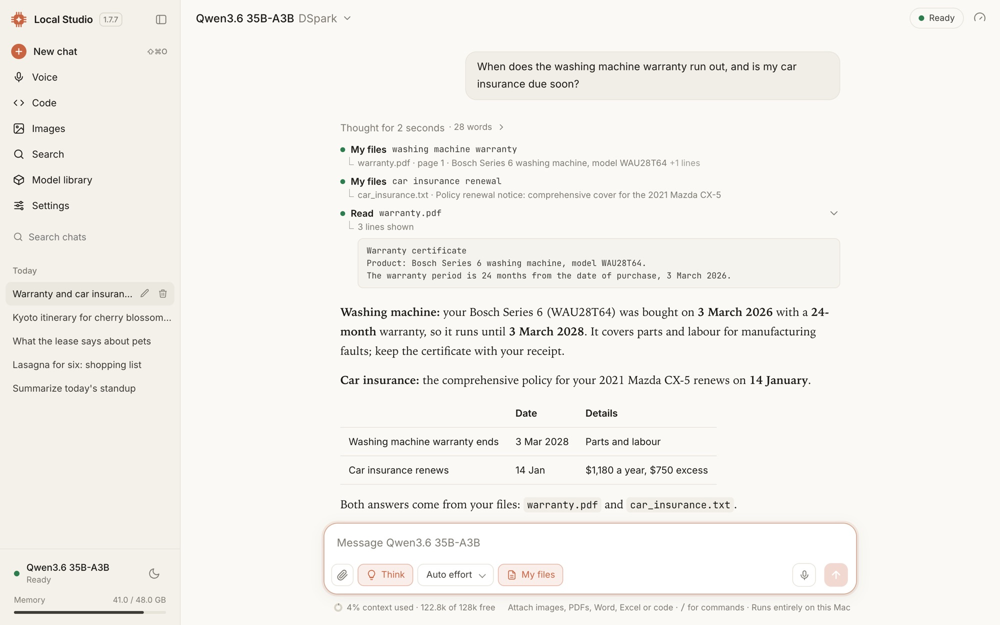
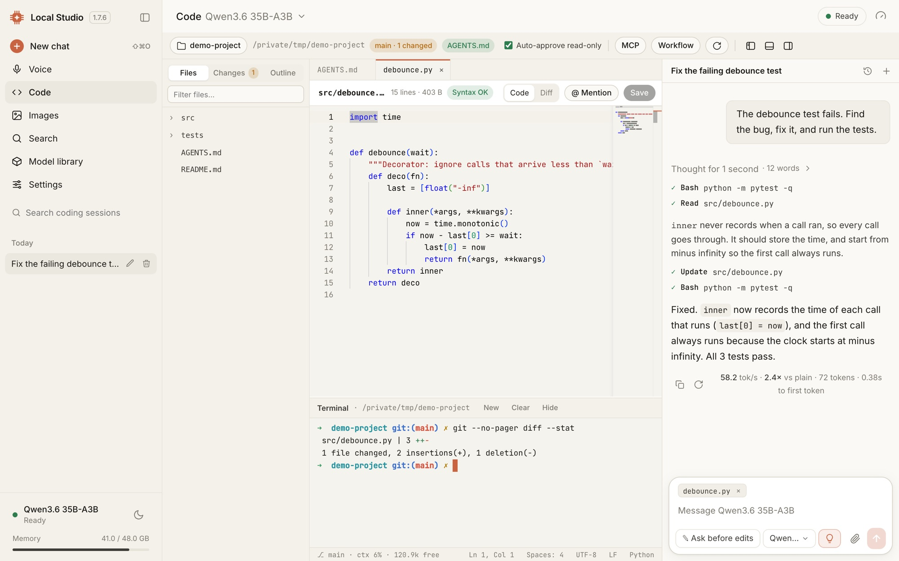
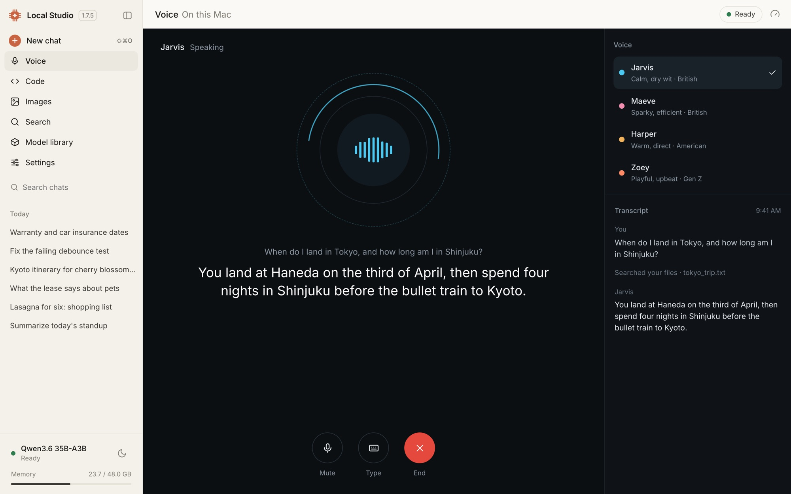
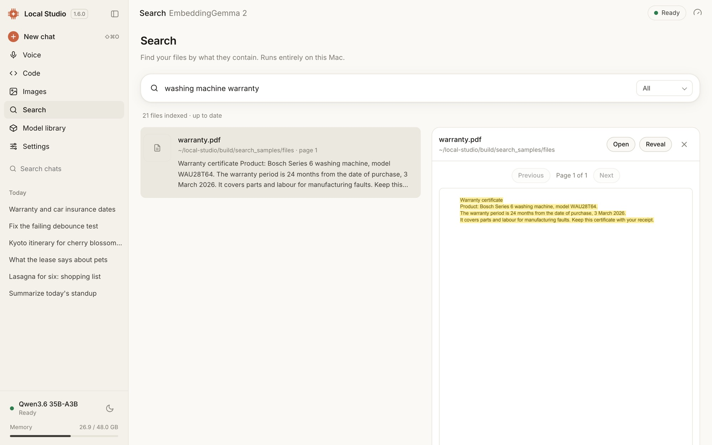
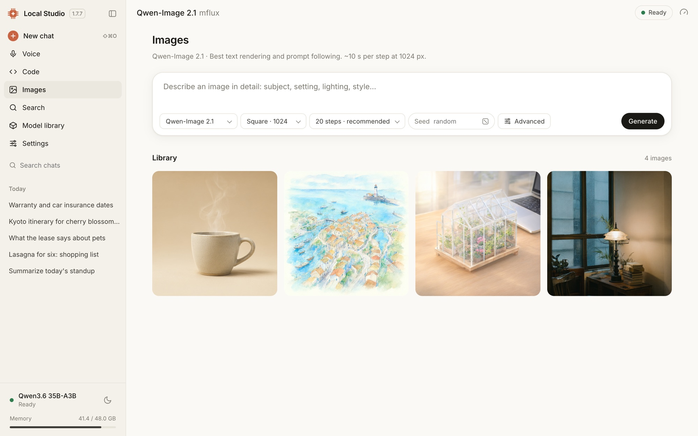

<p align="center">
  
</p>

<h1 align="center">Local Studio</h1>

<p align="center">
  <b>A private AI studio that runs on your Mac.</b><br>
  Chat, code, talk, search your files and make images with open models. Your chats and files stay on this Mac.
</p>

<p align="center">
  <a href="https://github.com/vinoth12940/local-studio/releases/latest"></a>
  
  
  <a href="LICENSE"></a>
</p>

<p align="center">
  <a href="https://github.com/vinoth12940/local-studio/releases/latest"><b>⬇️ Download for Mac</b></a>
  &nbsp;·&nbsp; <a href="#what-it-does">What it does</a>
  &nbsp;·&nbsp; <a href="#install">Install</a>
  &nbsp;·&nbsp; <a href="#privacy">Privacy</a>
  &nbsp;·&nbsp; <a href="docs/GUIDE.md">Guide</a>
</p>

<picture>
  <source media="(prefers-color-scheme: dark)" srcset="docs/screenshots/chat-dark.jpg">
  
</picture>

## Why Local Studio

- **Private by design.** Models run on your Mac. Conversations, documents, the file index and voice audio never leave
  it. The app itself loads nothing from the internet.
- **Fast on Apple Silicon.** MLX models with DFlash and DSpark speculative decoding run 2–3× faster than plain decoding.
  Any GGUF model runs on llama.cpp.
- **It does the work.** Every chat is an agent. It can search the web, read your documents, edit code and run your
  tests, asking before anything changes.
- **One app.** Chat, a coding workbench, voice, file search, computer use and image generation share one model library.

## What it does

<table>
  <tr>
    <td width="50%" valign="top">
      
      <b>Code.</b> An explorer, editor and real terminal beside the agent, which edits files with diff previews and
      one-click Undo, runs your tests, and has <code>/review</code>, <code>/test</code> and <code>/commit</code>.
    </td>
    <td width="50%" valign="top">
      
      <b>Voice</b> <i>(preview)</i>. Talk hands-free and interrupt any time. The microphone is echo-cancelled, there are
      13 voices, and speech is recognized and spoken on this Mac.
    </td>
  </tr>
  <tr>
    <td width="50%" valign="top">
      
      <b>Search your files.</b> Describe what you're looking for. It finds documents, PDFs and scans, photos, voice memos
      and videos, and opens the page where it matched.
    </td>
    <td width="50%" valign="top">
      
      <b>Images.</b> Text-to-image with Qwen-Image 2.1, Z-Image Turbo or FLUX.2 Klein, with live progress, seeds and a
      library.
    </td>
  </tr>
</table>

- **Chat** with thinking you can open, live tool steps, attachments (images, PDFs, Word, Excel, code), and speed shown
  under every reply.
- **Your documents in chat.** Turn on **My files** and it answers from your own documents, naming the ones it used.
- **Computer use** *(experimental).* It drives an isolated Chrome or your Mac apps, with per-app permissions and an
  approval for every risky step.
- **[Model library](docs/screenshots/models.jpg).** One-click downloads of curated models, plus any MLX or GGUF model
  from Hugging Face.
- **Local API.** OpenAI- and Anthropic-compatible endpoints at `http://127.0.0.1:8080/v1` for your own scripts and apps.

The [guide](docs/GUIDE.md) covers every tool, limit and setting.

## Install

1. Download **Local-Studio-1.7.10.dmg** from the [latest release](https://github.com/vinoth12940/local-studio/releases/latest).
2. Open it and drag **Local Studio** to **Applications**.
3. Open Local Studio and click **Install**. It sets up the engines: about 3 GB and a few minutes, with no Terminal,
   Homebrew or Xcode.
4. Pick a model. Local Studio suggests ones that fit your Mac's memory; chat unlocks when the download finishes.

The DMG is signed with a Developer ID and notarized by Apple, so it opens without a warning. Each release lists its
SHA-256.

**You need:**
- **Mac:** Apple Silicon (M1 or newer), macOS 14 Sonoma or later.
- **Memory:** 16 GB for small models, 32 GB or more for the larger ones; 48 GB is recommended.
- **Disk:** about 3 GB for the engines, plus 3–25 GB per model.
- **Internet:** for setup, model downloads and web search. Everything else works offline.

### Optional features

- **Search your files:** Settings → Search. It downloads its model (1.3 GB) and components (about 1 GB) once, then
  indexes in the background.
- **Computer use:** Settings → Computer access. It needs [CuaDriver](https://github.com/trycua/cua) 0.28.2 or newer,
  with its Accessibility and Screen Recording permissions, and Google Chrome.
- **Voice** *(preview):* Settings → Voice and web answers. The same section turns on the live-facts check for voice
  and faster web answers. See the [guide](docs/GUIDE.md#voice-preview).

### Handy shortcuts

| Keys | Does |
|---|---|
| <kbd>⇧</kbd><kbd>⌘</kbd><kbd>O</kbd> | New chat |
| <kbd>1</kbd> <kbd>2</kbd> <kbd>3</kbd> | Answer an approval: yes, yes for this chat, no and say what to do instead |
| <kbd>Esc</kbd> | Stop a reply, or decline an approval |
| <kbd>⇧</kbd><kbd>Tab</kbd> | Accept edits inside the workspace until you quit |
| <kbd>@</kbd> and <kbd>/</kbd> | Mention a file or folder; run a command such as `/review` or `/compact` |

## Privacy

**Stays on your Mac:** the models, your conversations, attached files, the file index and its previews, and voice audio
(which is never saved). The interface is bundled with the app, fonts included.

**What goes out, and only when needed:**
- Setup downloads the engines from PyPI, GitHub and astral.sh (uv), and models come from Hugging Face.
- Web search queries go to DuckDuckGo, and pages are fetched when the model reads them.
- Computer-use tasks browse the sites you ask for. CuaDriver's own telemetry is on by default; Settings → Computer access
  turns it off.

**Safeguards:**
- Every server listens on `127.0.0.1` only.
- The file-search service also requires a private token, so other programs on the Mac can't read your index.
- Edits, commands and risky computer actions wait for your approval, and file edits can be undone.

Found a security problem? Please report it privately through [a security advisory](https://github.com/vinoth12940/local-studio/security/advisories/new), not a public issue.

## For developers

```sh
git clone https://github.com/vinoth12940/local-studio.git && cd local-studio
./setup.sh --install      # install the engines (or ./install.sh for engines plus default models)
./start.sh                # then open http://127.0.0.1:7860
./stop.sh                 # stop everything and free the memory
macos/build.sh --install  # build Local Studio.app, run every check, copy it to /Applications
```

| Path | What it is |
|---|---|
| `app.py`, `studio/` | The FastAPI backend: engines, the chat agent, tools, search, voice and computer use |
| `index.html`, `frontend/` | The interface: vanilla JS modules, with fonts, marked and xterm.js bundled in `frontend/vendor/` |
| `search.py`, `voice.py` | The file-search and voice services, each its own process |
| `macos/` | The native app, the DocumentReader OCR tool, every check suite, and build and release scripts |
| `docs/` | The [guide](docs/GUIDE.md) and the README's images |

**Checks.** `macos/build.sh` runs every check, and CI runs it on every pull request. Releases are signed, notarized and
published with `macos/release.sh --publish` (its setup notes are at the top of the script).

**Screenshots.** `macos/readme_screenshots.py` retakes the screenshots above from a demo server.

Issues and pull requests are welcome.

## License

Local Studio is released under the [MIT License](LICENSE). Each [release](https://github.com/vinoth12940/local-studio/releases)
lists what changed.

**Credits.** It builds on [mlx-dspark](https://github.com/ARahim3/mlx-dspark), [MLX](https://github.com/ml-explore/mlx),
[mlx-vlm](https://github.com/Blaizzy/mlx-vlm), [mflux](https://github.com/filipstrand/mflux),
[llama.cpp](https://github.com/ggml-org/llama.cpp), [Parakeet](https://huggingface.co/nvidia/parakeet-tdt-0.6b-v3) and
Phonon. These are installed separately under their own licenses.

**Model licenses.** Model weights come from Hugging Face under each model's license. Check the model card before
commercial use; some, such as Qwen-Image 2.1, are described as research or non-commercial.
